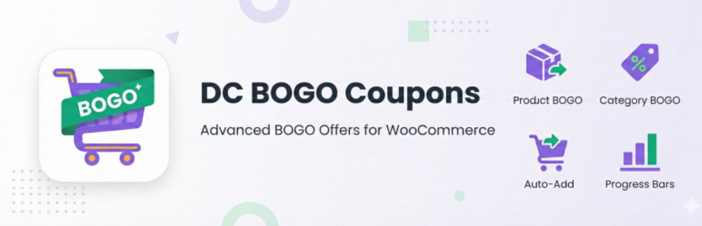
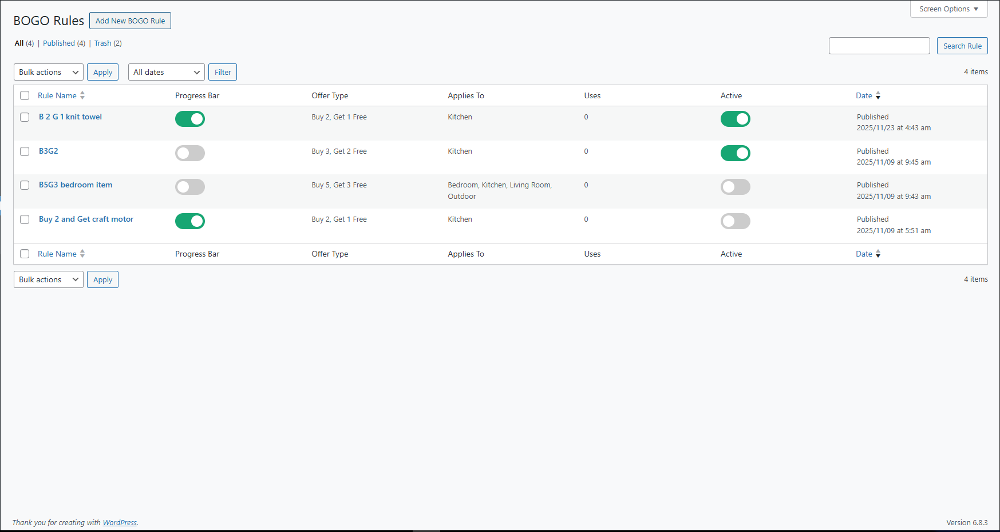
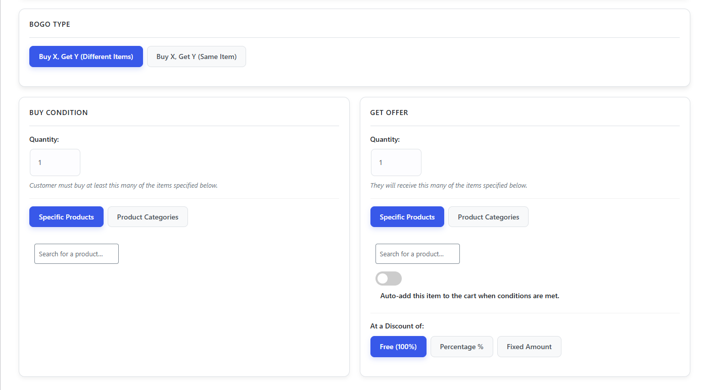
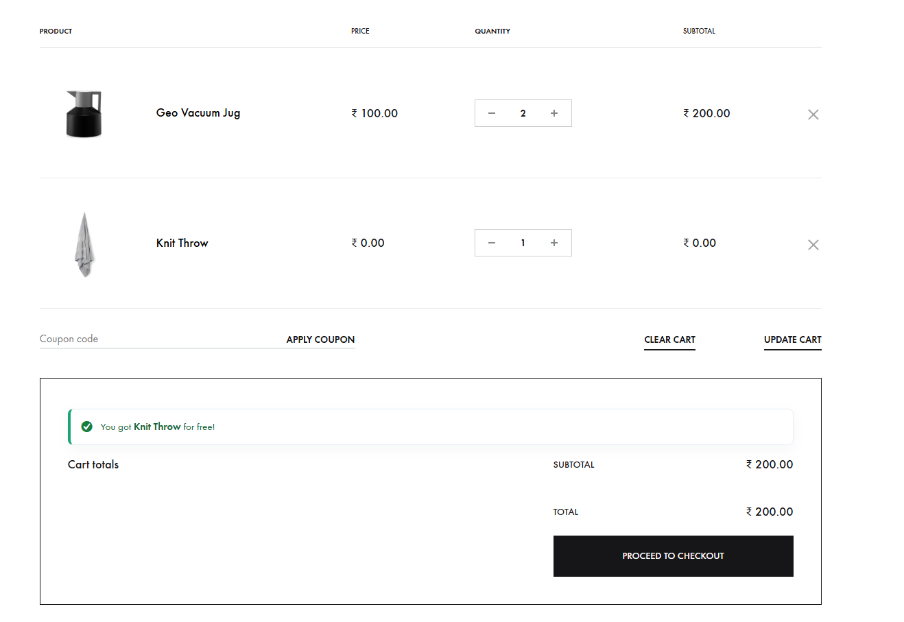
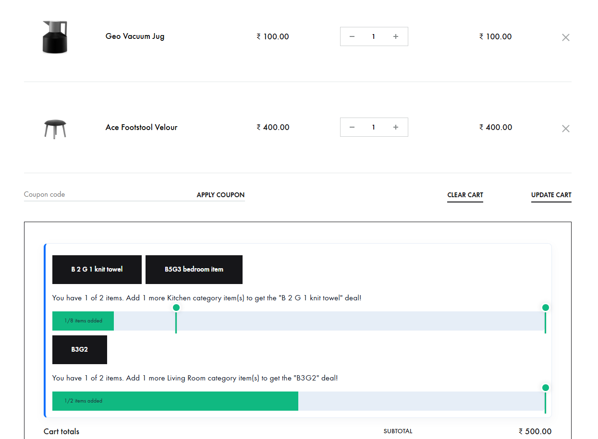
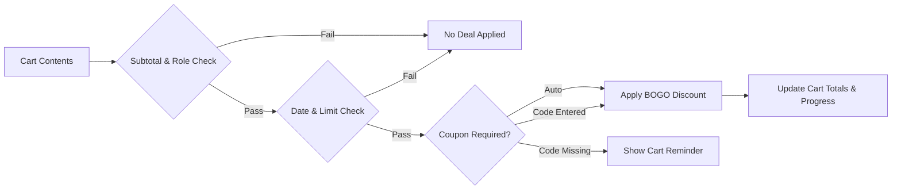

<div align="center">

# BOGO & Free Gift Coupons for WooCommerce — DC BOGO

<p align="center">
  <strong>The minimal, elegant, and powerful solution for creating advanced Buy One, Get One (BOGO) offers and automatic gift promotions in WooCommerce.</strong>
</p>

[](https://wordpress.org/plugins/dc-bogo-coupons/)
[](https://wordpress.org/plugins/dc-bogo-coupons/)
[](https://wordpress.org/plugins/dc-bogo-coupons/)
[](https://woocommerce.com/)
[](https://github.com/woocommerce/woocommerce/wiki/High-Performance-Order-Storage)
[](https://www.ramira.in/support/)
[](https://www.ramira.in/contact/)
[](https://wordpress.org/support/plugin/dc-bogo-coupons/reviews/#new-post)
[](LICENSE)

<br/>

<a href="https://wordpress.org/plugins/dc-bogo-coupons/">
  
</a>

<br/><br/>

[**Download on WordPress.org**](https://wordpress.org/plugins/dc-bogo-coupons/) &bull;
[**Hire Developer / Custom Work**](https://www.ramira.in/contact/) &bull;
[**Support & Donate**](https://www.ramira.in/support/) &bull;
[**Rate ★★★★★**](https://wordpress.org/support/plugin/dc-bogo-coupons/reviews/#new-post) &bull;
[**Report Bug / Issue**](https://github.com/Deadpool608/DC-BOGO-coupon/issues) &bull;
[**Author Website**](https://www.ramira.in/)

</div>

---

## 📌 Overview

**DC BOGO Coupons** is a streamlined, developer-crafted WooCommerce extension that allows store owners to configure high-converting Buy One, Get One (BOGO) promotions, free gifts with purchase, and tiered quantity discounts.

Unlike competing plugins that lock essential promotional features behind expensive recurring subscriptions, DC BOGO Coupons provides **full category-based BOGO rules and category discounts completely free**.

### 🌟 Why Choose DC BOGO?

* **100% Free Category Rules:** Create "Buy from Category A, Get item from Category B" without paying for a pro license.
* **Auto-Add Free Gifts:** Automatically insert free items or gifts into the cart the moment conditions are satisfied, complete with variable product variation handling and stock verification.
* **Dynamic Cart Reminders:** Prompt customers with exact product names (e.g., *"Add 1 more Knit Towel to get the deal!"*) rather than vague generic placeholders.
* **Live Interactive Progress Bar:** Real-time visual progress bar in the cart and shop motivating shoppers to unlock deals.
* **WooCommerce HPOS Certified:** Fully declared and tested with WooCommerce High-Performance Order Storage (`custom_order_tables`).
* **High Performance & Lightweight:** Built directly on WooCommerce hooks (`woocommerce_before_calculate_totals`) with transient rule caching to minimize database overhead.

---

## 📸 Screenshots & Interface Walkthrough

### 1. Centralized Rules Dashboard
Manage, monitor, and toggle all active BOGO campaigns from a dedicated, clean administrative screen.

<div align="center">
  
  <p><em>Figure 1: Complete rules list showing instant AJAX status toggles, progress bar switches, rule priorities, and lifetime usage tracking.</em></p>
</div>

---

### 2. Intuitive Rule Creation Interface
Set up complex promotion conditions in seconds with structured metaboxes, live search, and conditional field handling.

<div align="center">
  
  <p><em>Figure 2: Rule Setup screen featuring Buy/Get conditions, auto-add switches, discount types, usage limits, and scheduling.</em></p>
</div>

---

### 3. Smart Cart Reminders & Interactive Progress Bar
Engage customers directly in the cart before checkout to boost average order value (AOV).

<div align="center">
  
  <p><em>Figure 3: Real-time progress bar with customizable brand colors and dynamic milestone markers.</em></p>
</div>

---

### 4. Applied Deals & Transparent Savings Notices
Celebrate savings with clear customer feedback that builds trust and reinforces purchase intent.

<div align="center">
  
  <p><em>Figure 4: Automated savings notice displaying the applied deal name and exact monetary savings.</em></p>
</div>

---

## ⚡ Core Features

### 1. BOGO Rule Types
DC BOGO Coupons supports five distinct promotional combinations across products and categories:

| Rule Type | Logic | Real-World Example |
| :--- | :--- | :--- |
| **Buy X Get Y (Different Products)** | Specific product triggers discount on another specific product | *Buy a Leather Jacket, get a Leather Belt for 50% off.* |
| **Buy X Get X (Same Product)** | Customer buys quantity of a product and gets additional units of the same item | *Buy 2 T-shirts, get the 3rd T-shirt free.* |
| **Category to Specific Product** | Buying any item from a category unlocks a specific gift or discounted item | *Buy any Shoes, get a Pair of Socks auto-added free.* |
| **Specific Product to Category** | Buying a featured flagship item unlocks a discount across an entire accessory line | *Buy a Laptop, get 20% off any item in the Laptop Bags category.* |
| **Category to Category** | Buying from Category A unlocks a discount on qualifying items from Category B | *Buy 2 items from Apparel, get 1 item from Accessories free.* |

---

### 2. Discount Types & Calculation Engine
DC BOGO Coupons provides three core discount types applied directly at cart line-item calculation:

* **Free (100% Discount):** The item is provided completely free of charge ($0.00).
* **Percentage Discount:** Discount the target item by an exact percentage (e.g., 20%, 50%, 75% off).
* **Fixed Amount Discount:** Deduct a flat monetary value from the target item (e.g., $10.00 off per item).

#### Smart "Apply to Cheapest" Logic
When enabled, the discount calculation engine automatically evaluates all eligible items in the cart and discounts the lowest-priced items first. This ensures customers receive an equitable, predictable promotion while protecting merchant margins.

#### Multi-Item / Partial Quantity Price Averaging
When only a portion of a line-item's quantity is discounted (e.g., customer has 3 units in cart and qualifies for 1 at 50% off), DC BOGO Coupons calculates the exact weighted average unit price so WooCommerce totals, taxes, and shipping calculations remain 100% accurate.

---

### 3. Automatic Free Gift (Auto-Add)
Convert shoppers seamlessly by automatically adding promotional gifts to their cart:

* **Zero Customer Friction:** Qualifying free gifts appear in the cart immediately without requiring manual product selection.
* **Variable Product Intelligence:** Supports variable products by automatically selecting the defined default attributes, or gracefully falling back to the first available variation in stock.
* **Stock & Inventory Validation:** Verifies stock availability (`is_in_stock()` and `has_enough_stock()`) before attempting to auto-add items.
* **Dynamic Reversibility:** If the customer adjusts cart quantities below the qualification threshold, the auto-added promotional item is automatically cleaned up and removed.

---

### 4. Advanced Targeting, Limits & Scheduling



* **Repeatable Deals:** Choose whether a deal can trigger multiple times (e.g., Buy 1 Get 1, Buy 2 Get 2, Buy 3 Get 3).
* **Application Mode:**
  * **Automatic:** Applies instantly without requiring coupon input.
  * **Coupon Code Required:** Synchronizes with a native WooCommerce coupon code that customers must enter.
* **Usage Restrictions:**
  * **Total Store Usage Limit:** Cap total redemptions across all customers.
  * **Per-Customer Limit:** Limit redemptions per individual customer account via user metadata tracking.
  * **Cart Subtotal Restrictions:** Set minimum and maximum order subtotals required to activate the offer.
  * **User Role Targeting:** Restrict offers to specific user roles (e.g., `Customer`, `Wholesale`, `Subscriber`, or custom roles).
* **Scheduling:** Set optional Start Date and End Date for time-sensitive holiday campaigns (e.g., Black Friday, Cyber Monday).
* **Exclusivity & Priority:**
  * **Exclusive Rules:** Automatically remove other WooCommerce coupons if the BOGO deal qualifies.
  * **Priority Index:** Configure priority weighting so high-priority offers execute before fallback rules.
* **Conflict Resolution Strategies:** Configure global behavior under Settings when multiple deals qualify:
  * *Maximum Discount* (Recommended — guarantees the best customer deal)
  * *Minimum Discount*
  * *Closest to Completion*

---

### 5. Cart Progress Bar & Dynamic Notices
* **Milestone Progress Bar:** Displays real-time completion progress with customized accent color (`--dc-accent`).
* **Flexible Placement:** Position the progress bar either *Before Cart Totals* or *Above Cart*.
* **Shop Page Visibility:** Optional toggle to display the progress bar across your main Shop catalog.
* **"You Saved" Notice Box:** Display a branded celebration box highlighting exact customer savings.

---

## 📋 Requirements & Compatibility

| Component | Minimum Version | Tested Up To |
| :--- | :--- | :--- |
| **WordPress** | 5.0 | **7.0** (7.0.8 verified) |
| **WooCommerce** | 5.0 | **9.1** |
| **PHP** | **7.4** | **8.0, 8.1, 8.2** |
| **WooCommerce HPOS** | Compatible | Declared (`custom_order_tables`) |

---

## 🚀 Installation

### Option 1: Via WordPress Admin (Recommended)
1. In your WordPress dashboard, navigate to **Plugins > Add New Plugin**.
2. Search for `DC BOGO Coupons` or `dc-bogo-coupons`.
3. Click **Install Now**, then click **Activate**.
4. Access your new dashboard under **Marketing > BOGO Coupons**.

### Option 2: Manual ZIP Installation
1. Download the latest release `.zip` from the [official WordPress.org repository](https://downloads.wordpress.org/plugin/dc-bogo-coupons.1.1.5.zip).
2. In your WordPress admin, go to **Plugins > Add New Plugin > Upload Plugin**.
3. Choose the downloaded ZIP file and click **Install Now**.
4. Activate the plugin upon completion.

### Option 3: Developer / Git Installation
Clone the repository directly into your local WordPress plugin directory:

```bash
cd wp-content/plugins/
git clone https://github.com/[YOUR-USERNAME]/dc-bogo-coupons.git dc-bogo-coupons
```

Activate via WP-CLI:
```bash
wp plugin activate dc-bogo-coupons
```

---

## 🛠️ Quick-Start Usage Guide

### Creating Your First "Buy 1, Get 1 Free" Deal:

1. **Navigate to Rules:** Go to **Marketing > BOGO Coupons** and click **Add New Rule**.
2. **Name the Offer:** Enter an **Offer Name** (e.g., *"Summer Sale B1G1"*). This name appears in customer cart notices.
3. **Select BOGO Type:**
   - Choose **Buy X, Get Y (Same Item)** for standard B1G1 deals.
   - Choose **Buy X, Get Y (Different Items)** for cross-product deals.
4. **Define Quantities & Conditions:**
   - Set **Buy Quantity** to `1`. Select your eligible products or product categories.
   - Set **Get Quantity** to `1`. Select the target gift item.
5. **Configure Discount:**
   - Select **Free (100%)**, **Percentage %**, or **Fixed Amount**.
   - Check **Auto-add this item to the cart** if you want the gift inserted automatically.
6. **Set Advanced Options (Optional):**
   - Toggle **Allow rule to be applied multiple times** for repeat deals (Buy 2 Get 2, etc.).
   - Set date ranges, role restrictions, or minimum subtotals under **Usage Restrictions**.
7. **Activate & Save:**
   - Toggle **Activate Rule** in the right-hand status metabox.
   - Click **Publish** / **Save Changes**.

---

## 📂 Repository Structure

```text
dc-bogo-coupons/
├── dc-bogo-coupons.php          # Main plugin loader & HPOS compatibility declaration
├── admin.js                     # Admin UI scripts, enhanced selects, and AJAX handlers
├── admin-styles.css             # Administrative styles
├── dc-bogo-frontend.js          # Cart event listeners, live progress updater & popper effects
├── frontend-styles.css          # Frontend progress bar, deal milestones, and notice styles
├── LICENSE                      # GNU General Public License v2 text
├── LICENSE.txt                  # Original WordPress.org license file
├── readme.txt                   # Official WordPress.org plugin directory readme
├── README.md                    # Flagship GitHub documentation
├── CHANGELOG.md                 # Semantic version changelog
├── CONTRIBUTING.md              # Contributor onboarding and development standards
├── uninstall.php                # Clean uninstallation routine
├── .github/
│   ├── FUNDING.yml              # Project funding configuration
│   ├── PULL_REQUEST_TEMPLATE.md # Structured pull request template
│   └── ISSUE_TEMPLATE/
│       ├── bug_report.md        # Bug reporting template
│       └── feature_request.md   # Feature enhancement request template
├── docs/
│   └── images/                  # Official screenshots, banners, and icons
├── includes/
│   ├── class-dc-bogo-coupons.php        # Core singleton orchestrator
│   ├── class-dc-bogo-cpt.php            # Custom post type registration (dc_bogo_rule)
│   ├── class-dc-bogo-admin.php          # Admin screens, metaboxes & coupon synchronization
│   ├── class-dc-bogo-cart.php           # BOGO calculation engine, auto-add & pricing hooks
│   ├── class-dc-bogo-frontend.php       # Cart notices, progress bar renderer & savings box
│   ├── class-dc-bogo-ajax.php           # AJAX endpoints with nonces and rate limiting
│   ├── dc-bogo-admin-field-helpers.php  # Select dropdown helpers (products, categories, roles)
│   └── images/
│       └── icon-20x20.png               # Admin menu icon
└── languages/                           # Localization files
```

---

## ❓ Frequently Asked Questions

<details>
<summary><strong>Does DC BOGO Coupons work with variable products?</strong></summary>

**Yes!** DC BOGO Coupons fully supports variable products. You can specify exact variations or entire parent products. When auto-adding a variable product to the cart, the plugin automatically detects and adds the product's defined default variation attributes, or falls back to the first available in-stock variation.
</details>

<details>
<summary><strong>Are category-based BOGO deals completely free?</strong></summary>

**Yes, 100% free.** Unlike other BOGO plugins that restrict category rules to paid "Pro" upgrades, DC BOGO Coupons includes complete category matching (Buy from Category, Get Product; Buy Product, Get from Category; Buy Category, Get Category) in the free version.
</details>

<details>
<summary><strong>Does it support both automatic discounts and coupon codes?</strong></summary>

**Yes.** Each rule can be configured to apply automatically once cart conditions are satisfied, or require customers to enter a specific coupon code. In coupon mode, the plugin automatically synchronizes a companion WooCommerce coupon in the background.
</details>

<details>
<summary><strong>Can I restrict offers to specific user roles or VIP members?</strong></summary>

**Yes.** You can restrict any offer to specific WordPress user roles (such as `Customer`, `Wholesale`, `Subscriber`, or custom roles). Leaving the role selector blank makes the offer available to all logged-in users and guests.
</details>

<details>
<summary><strong>What happens if the customer reduces their cart quantity below the required threshold?</strong></summary>

The plugin dynamically evaluates cart quantities on every cart update. If an auto-added gift no longer qualifies, it is automatically removed from the cart, preventing unauthorized free items.
</details>

<details>
<summary><strong>Is the plugin compatible with WooCommerce High-Performance Order Storage (HPOS)?</strong></summary>

**Yes.** HPOS compatibility is explicitly declared and verified (`\Automattic\WooCommerce\Utilities\FeaturesUtil::declare_compatibility( 'custom_order_tables', __FILE__, true )`).
</details>

---

## 🤝 Contributing

We welcome contributions, bug fixes, and suggestions from the community!

1. Read our **[Contributing Guidelines](CONTRIBUTING.md)** for coding standards, environment setup, and pull request procedures.
2. Check existing **[Issues](https://github.com/[YOUR-USERNAME]/dc-bogo-coupons/issues)** before creating new reports.
3. For major architectural proposals, open a discussion or feature request first.

---

## 🛡️ Security & Bug Reports

If you discover a security vulnerability or critical bug, please submit a detailed report via the [Bug Report Template](.github/ISSUE_TEMPLATE/bug_report.md) or open an issue on the [WordPress.org Support Forum](https://wordpress.org/support/plugin/dc-bogo-coupons/).

---

## 📄 License & Credits

* **Author:** [Dipak Chaudhari](https://profiles.wordpress.org/deadpool608/)
* **Website:** [ramira.in](https://www.ramira.in/)
* **WordPress.org Profile:** [@deadpool608](https://profiles.wordpress.org/deadpool608/)
* **License:** [GNU General Public License v2 or later (GPL-2.0-or-later)](LICENSE)

*This project is free software: you can redistribute it and/or modify it under the terms of the GNU General Public License as published by the Free Software Foundation.*

---

<div align="center">
  <sub>Built with care for the WooCommerce and WordPress open-source community by Dipak Chaudhari.</sub><br/>
  <sub>⭐ If you find DC BOGO Coupons helpful, consider giving it a star on GitHub and leaving a review on WordPress.org! ⭐</sub>
</div>

